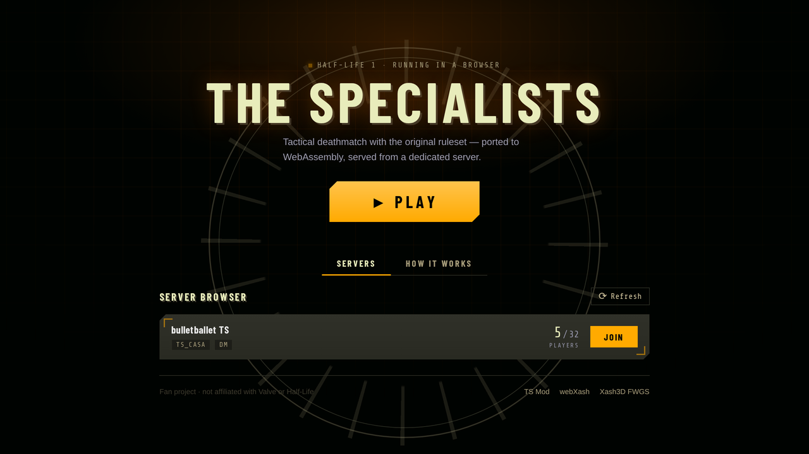
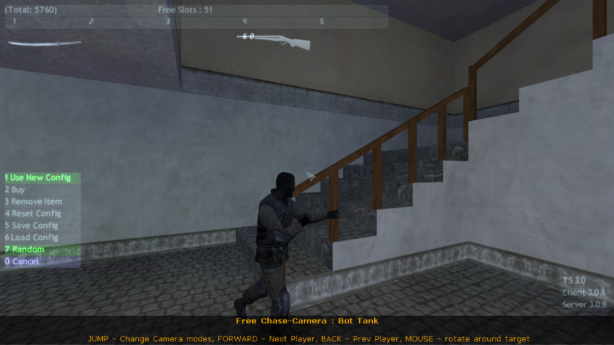

# specialists-browser

> **The Specialists** — a Half-Life 1 mod — running in a browser tab, played
> against a real dedicated server. No Steam client, no native binary.

<table>
  <tr>
    <td align="center" valign="top" width="50%">
      <b>bulletballet.dev</b><br>
      
    </td>
    <td align="center" valign="top" width="50%">
      <b>In game</b><br>
      
    </td>
  </tr>
</table>

> **Status: production.** Live at <https://bulletballet.dev>, with real
> players in a real dedicated server. The first run downloads a 493 MB game
> archive; after that it is cached in the browser.
>
> See [Production](#production) for the topology and
> [What is proven](#what-is-proven) for exactly what has been verified.

---

## Where to start

- **New to the project?** Read [`HANDOFF.md`](./HANDOFF.md) — current state,
  roadmap, and the next task.
- **Designing or modifying the approach?** Read [`SPEC.md`](./SPEC.md).
- **An AI agent working on this repo?** Read [`AGENTS.md`](./AGENTS.md).
- **Chasing a blocked feature?** Read
  [`docs/UPSTREAM-ISSUES.md`](./docs/UPSTREAM-ISSUES.md) before starting
  work — several symptoms share one upstream root cause.
- **Deploying or operating it?** Read
  [`docs/PRODUCTION-INFRA.md`](./docs/PRODUCTION-INFRA.md) and
  [`docs/CONTROL-PLANE.md`](./docs/CONTROL-PLANE.md).

---

## The four things that make it work

None of them is obvious, and each one cost a debugging round.

1. **A Rust port of the TS game logic** compiles to a WebAssembly *side
   module* that the stock Xash3D engine loads, so the game rules are real
   code, not a JavaScript reimplementation.
2. **A WebSocket↔UDP bridge**, because a browser cannot emit UDP and the
   engine's network stack speaks it natively.
3. **A command bridge**, because the published WASM build never drains its
   SDL event queue and no keyboard event reaches the game.
4. **A gate fix in the port**, because TS deliberately refuses to run nine
   button commands unless a physical keypress opened them.

### 1. The Rust port as a WASM side module

`tools/port/tsp-rs/` is a vendored copy of `the-specialistsmod-rs` (pinned
in `PINNED-VERSION`), a Rust reimplementation of The Specialists' gameplay.
It builds twice from one source tree:

| Target | Crate | Produces |
|---|---|---|
| `wasm32-unknown-emscripten` | `ts-client` | `client_emscripten_wasm32.wasm` — the client DLL |
| native `x86_64` | `ts-server` + `ts-server-dll` | the dedicated server |

The client DLL is a **side module**, not a standalone program. The engine
resolves its exports through a `DLINK` export table at boot, exactly as it
does for a native `.dll`. That is why the port can be dropped into the
stock engine without touching engine code.

```bash
tools/port/tsp-rs/scripts/build-wasm.sh              # → dist/
tools/port/tsp-rs/scripts/deploy-wasm-to-webxash.sh   # → webxash/public/cl_dlls/
```

Always deploy with the script. Hand-copying the artifact is how you end up
debugging a build that was never served.

### 2. The WebSocket↔UDP bridge

`tools/port/tsp-rs/scripts/ts-udp-bridge.js`. The engine's `net_ws.c` calls
POSIX `sendto`/`recvfrom`; Emscripten's socket emulation falls back to `-1`
for every call when `Module.net` is undefined, with no warning. The bridge
supplies it.

Non-obvious requirements, each of which cost a debugging round:

- **One UDP socket per WebSocket connection.** The engine keys clients on
  source `address:port`, so a shared socket gives every browser the same
  client slot.
- **Inbound packets must be stamped with the real peer address** parsed
  from `+connect <ip>:<port>`. The engine drops any datagram whose source
  does not match `cls.serveradr` (or loopback) *after* reading it — no
  error, no log. A loopback placeholder is correct for WebRTC P2P and
  silently fatal for a dedicated server.
- **`/health` with byte and packet counters.** It is the only way to
  distinguish "transport dead" from "handshake wrong" without a browser in
  the loop.
- **`-noip`/`-noip6` must be absent from launch args.** With both set the
  engine prints `TCP/IP Disabled.` and returns before ever calling
  `socket()`, which looks exactly like a broken transport.

In production the bridge is **multi-target and allowlisted**. Without an
allowlist it is an open UDP relay: anyone who can open a WebSocket can
make the host send packets to anything it can reach. The registry may tell
the bridge *where* to send a packet; only the floor says whether it is
*allowed* to — `127.0.0.1` on a static port range. Unknown targets are
refused **before** the handshake, with a plain 403, because a connection
that opens and then closes reads to the client as "connected".

### 3. The command bridge

The published `xash.wasm` never calls `SDL_PollEvent`, so nothing drains
the SDL queue: a pushed `SDL_KeyboardEvent` is *accepted* (returns `1`)
and then sits there forever, alongside the engine's own window and
audio-device events. No key event ever reaches `HUD_Key_Event`.

So `keyboard-bridge.ts` listens for DOM keys directly and execs engine
**commands** through `Cmd_ExecuteString`. This covers movement, weapon
slots, the scoreboard, the console toggle, and spawn.

**Its ceiling:** anything implemented as a client-DLL *key handler* —
clicking an item in the buy menu, typing into the console — stays
unreachable. That is structural, not a bug, and it is upstream's to fix.

Two things about this bridge that are easy to get backwards:

- **Held vs instant.** `+showscores`/`-showscores` is a button and must be
  held; `toggleconsole` is a plain action and must be sent **bare**.
  `Cmd_ExecuteString` looks up `argv[0]` literally, so sending
  `+toggleconsole` prints `Unknown command: +toggleconsole`. Probe both
  spellings; the two tables are not derivable from each other.
- **Grep both wasms.** Engine-owned commands (`showscores`,
  `toggleconsole`) live in `xash.wasm`; client-DLL commands (`slot1`,
  `buy`) live in the client wasm. A missing symbol from one binary is not
  evidence the command doesn't exist.

### 4. `ts_gate` — the anti-script gate

TS makes nine button commands reachable only after a real keypress:

```rust
// crates/client/src/input.rs
fn gate_open() -> bool { REAL_KEY.0.get() || !input_gate() || dev_input_allowed() }
// REAL_KEY: set only by HUD_Key_Event, cleared by HUD_Frame
```

`+attack +attack2 +alt2 +reload +forward +back +moveleft +moveright +jump`

With the SDL path dead, `HUD_Key_Event` never runs, so `REAL_KEY` is never
set and **all nine are discarded silently** — no error, no log. Firing did
nothing at all. Movement only looked healthy because the non-gated movement
bindings take a different path.

`ts_gate <1-500>` sets `REAL_KEY` for the current frame, the same lifetime
a real keypress gives it. The bridge calls it immediately before any gated
command. It is **not** a blanket bypass: bounded duration, caller is the
bridge, and `HUD_Frame` re-arms the gate exactly as before.

---

## Production

```
browser
  │  https://bulletballet.dev/
  ▼
Caddy (Let's Encrypt, cert valid to 2027-01-21)
  ├── /              → /srv/web          app bundle, 56 MB
  ├── /api/servers   → 127.0.0.1:8081    registry container
  └── /bridge        → 127.0.0.1:27017   bridge container (WebSocket)
                                              │
                                              └─ UDP → 127.0.0.1:27015 → ts-0

assets.bulletballet.dev  →  Cloudflare R2 (ts-assets), 493 MB in 8×64 MiB parts
```

The game UDP port is published straight out of Docker and deliberately does
**not** go through Caddy — it is raw UDP, not HTTP.

### The four containers

| Container | Role |
|---|---|
| `ts-0` | the dedicated server — 32 slots, tickrate 100, map `ts_casa` |
| `bridge` | WebSocket↔UDP, allowlisted, refuses unknown targets with 403 |
| `registry` | the fleet's source of truth — A2S, tickrate, bot count, health |
| `orchestrator` | the decision maker — restart unhealthy, scale out, scale in |

### Asset delivery

The game archive is 493 MB, which is larger than a browser will hold in
memory as one blob and larger than is sensible to serve uncompressed. It is
split into eight 64 MiB parts plus a manifest, uploaded to Cloudflare R2,
and served through the Cloudflare edge with immutable caching.

The edge is the point: the first player to fetch a part warms it for
everyone after. A cold fetch measures ~41 MiB/s from a fast link; a warm
one is served from the edge.

Two traps live here, both documented in
[`docs/ASSET-DELIVERY.md`](./docs/ASSET-DELIVERY.md):

- **The storage key layout must mirror the dev-served layout exactly.**
  On localhost the two lookups are independent and one of them succeeds,
  so the mismatch does not show up until it hits a real bucket — as a
  total 404 of the delivery path.
- **`vary: Origin` means a cached pre-policy response keeps missing its
  CORS header** until that per-origin variant is purged. A policy in the
  wrong shape is accepted, renders plausibly, and does nothing.

### The control plane

The **registry observes** and the **orchestrator decides**. They are
separate services on purpose: a registry bug cannot take the fleet down,
and two services measuring the same thing is how they end up disagreeing.

Three policies, all of them settled rather than accidental:

- **Degradation is sustained, with hysteresis and a cooldown.** A tickrate
  dip of one or two frames happens on a map change, a bot respawn, a GC
  pause. Degrade below 85%, recover only above 95%, sustained 30s, and a
  180s cooldown before touching the same instance again.
- **An instance is down only after three consecutive failed probes.** One
  missed UDP probe must not restart a healthy server with players on it.
- **Bots yield to humans.** The bot roster is `4 − humans`, scaled by the
  registry and applied with `ts_bot_quota`. A lone player has something to
  fight; a full server has nobody in the way.

### Capacity

"Eight instances of 32 slots on this box" is **a plan, not a promise**.

| Bound | Number |
|---|---|
| RAM-bound | ~9 instances (365.5 MB measured each) |
| CPU-bound | ~4–5 (2 vCores, shared with Caddy and three Node services) |

The bounds disagree and **CPU is the one that binds**. The RAM figure is
an upper bound even on its own terms: 365.5 MB was measured with four bots
and no players. The number that would move it is a real 32-player
instance, which is the metric we do not have yet.

---

## What is proven

Verified from a real browser against production, not from a test harness:

```
raw A2S:  players=5  max=32  bots=4     ← four bots and a player
registry: ts-0 · ts_casa · tick=100 · humans=1 · bots=3
engine console: BUILD 4221 SERVER (0 CRC) → FS_AddGameHierarchy( ts )
```

- **Two browsers in the server at once**, each with its own server-side
  client slot, with the bot roster scaling down as they arrived.
- **A player joining from a cold browser**, downloading 493 MB, booting
  the engine, and appearing on the server's player count.
- **The server dying under a live player**, and the client saying so
  ("The game server is restarting") and reconnecting on its own.
- **The server being restarted by the orchestrator** (~80s from dead to
  healthy) without touching a healthy instance.

Run it yourself:

```bash
node tools/deploy/two-player-e2e.cjs https://bulletballet.dev/ 2
node tools/deploy/play-button-e2e.cjs https://bulletballet.dev/
node tools/deploy/disconnect-ux-test.cjs https://bulletballet.dev/
```

The first checks that two browsers are in the server *at the same time*,
the second that the **Play** button reaches it, and the third that a
player is told when the server goes away.

### Known limitations

- **The first run downloads 493 MB.** ~30–40s on a 100 Mbps link, ~90s on
  50 Mbps, ~6 minutes on a slow mobile connection. Cached after that.
- **Browser floor.** The engine needs cross-origin isolation for
  `SharedArrayBuffer`: Chrome and Edge are fine, Firefox 119+, Safari 18+.
- **The player count lags by up to two minutes** after someone leaves — the
  server holds the slot until its own timeout fires.
- **Blocked upstream** (see [`docs/UPSTREAM-ISSUES.md`](./docs/UPSTREAM-ISSUES.md)):
  client-DLL menus needing `HUD_Key_Event` (clicking buy-menu items),
  console text input (needs SDL text events), and a bare `reload` that
  aborts the wasm heap on first call.

---

## Repo layout

| Path | What it is |
|---|---|
| `webxash/` | Vue frontend + the WASM engine (git submodule, branch `phase-0-stub-fix`) |
| `tools/port/tsp-rs/` | Vendored Rust port of TS gameplay |
| `tools/port/tsp-rs/crates/ts30/`, `ts21/` | TS 3.0 / 2.1 rulesets |
| `tools/port/tsp-rs/scripts/` | Build, deploy, server, bridge, and probe scripts |
| `tools/deploy/` | Container images, Caddy config, instance runner, e2e tests |
| `tools/assets/` | Archive splitter and R2 uploader |
| `services/registry/` | The fleet registry |
| `services/orchestrator/` | The fleet orchestrator |
| `services/a2s/` | The original A2S service the registry grew out of |
| `docs/` | Production topology, control plane, asset delivery, upstream issues, historical scopes |
| `SPEC.md` | Living design spec |
| `HANDOFF.md` | Current state and the next task |
| `progress/` | Decompilation logs from the original porting effort |

The vendored port is pinned by `PINNED-VERSION`. It is a copy, not a
submodule, so the build stays reproducible offline.

---

## Development setup

```bash
# 1. Dedicated server (UDP 27015), data root /tmp/tsds
tools/port/tsp-rs/scripts/start-ts-server.sh

# 2. WebSocket↔UDP bridge (WS 27017)
tools/port/tsp-rs/scripts/start-bridge.sh

# 3. Frontend (Vite)
cd webxash && npm run dev
```

Then open the Vite URL with the connect address:

```
https://<host>:5174/?launchOptions=-game+ts+%2Bconnect+<host>%3A27015+%2Bmaxplayers+8
```

Append `&debug=1` for session-level logging, `&debug=trace` to also trace
every packet, `&hud=vue` to show the Vue HUD (hidden by default so it
cannot occlude the real one).

**The app is served from `/`, not `/webXash/`.** The Vite `base` has to
match where it is actually served, or the entry module 404s and the page
renders blank with an empty console.

---

## Server configuration

Stock TS is **free-for-all deathmatch**. The shipped `server.cfg` does not
set `mp_teamplay` (default `0`). The four visible "teams" are character
*model* groups from `mp_teammodels`, not sides.

Two values that will bite if set wrong:

- **`ts_gameplay`** selects the ruleset. `30` is TS 3.0 (default, ignores
  map prefix); `21` is TS 2.1 (map-aware). The client WASM is built
  `--features ts30` **only** — running the server on `21` desyncs, and the
  engine says so on every connect: `the server's ruleset "21" isn't in
  this client; predicting with "30"`.
- **`mp_defaultteam 1`** is not an auto-assign switch. In this port it
  triggers a path that overwrites the client's `model` key with the team
  name and prints `* HLDM models not allowed.` Leave it `0` and use
  `mp_teamoverride 1`.

A third trap: the config parser tokenizes bare cvar assignments inside
`//` comments as commands. A comment line like `// ts_gameplay 21 means…`
becomes a command and logs `log: unknown parameter 1`.

For a headless dedicated you need a stdin channel to run server commands:

```bash
echo "ts_status" >> /tmp/tsds/engine.console
```

`start-ts-server.sh` tails that plain file into the server's stdin. **Not a
named FIFO** — a FIFO blocks on open until a peer arrives, so a dead
reader hangs the next start forever while the script still exits 0.

---

## Testing

```bash
# Browser → server smoke test
tools/port/tsp-rs/scripts/smoke-browser-to-server.js

# Frontend only
tools/port/tsp-rs/scripts/smoke-webxash.js
```

Probes live in `tools/port/tsp-rs/scripts/probes/`. Archived investigation
scripts are under `.../probes/d7-keyboard-investigation/` — they are kept
because the negative results are what ruled out whole theories.

The production suite lives in `tools/deploy/` and runs against the live
site — a real browser, a real server, and the server's own player count as
the verdict:

| Script | What it proves |
|---|---|
| `two-player-e2e.cjs` | N browsers are in the server *at the same time* |
| `play-button-e2e.cjs` | The **Play** button reaches the server |
| `disconnect-ux-test.cjs` | A player is told when the server goes away |
| `capture-readme-shots.cjs` | Regenerates this README's screenshots |

Two probe rules learned the hard way, worth keeping:

- **A negative result from an unvalidated probe is not evidence.** Always
  run a positive control — a DOM-level listener proving the event actually
  arrived — before concluding the engine never saw it.
- **Instrument the suspect function before you patch it.** A guard in a
  function that is never invoked looks identical to a guard that does not
  work. One `print` at the top of your own handler is the discriminator.

And one that cost a real bug: **a test that only covers the path you
already trust is not evidence about the path you have not tried.** Every
e2e test here originally matched `/join/i` — a server row's *Join* button —
so the suite was exercising the path that already worked while the *Play*
button was broken, and every run passed.

---

## Deliberately not done

**CheerpX.** The original plan ran TS's closed-source x86 DLLs unmodified
via an x86 emulator in WASM. Shipping a Rust port instead removed the
emulator, the dual-mode build, and a whole class of "is it the port or is
it CheerpX?" ambiguity.

---

## License

Repo content is MIT. The engine and mod content are **not** covered by
this license: users source those separately and are bound by Valve's HL1
SDK terms and The Specialists mod's distribution terms.

The game archive is served from a public R2 bucket on Cloudflare. That is
a deliberate call — the browser needs the content, and the server image
stays clean because the assets live in a read-only volume and are never
baked into an image.
