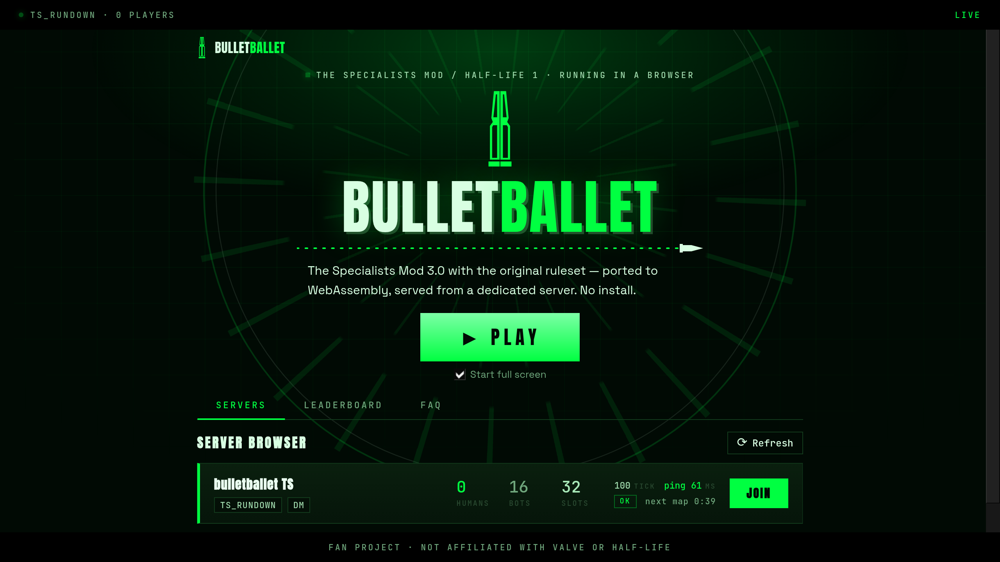
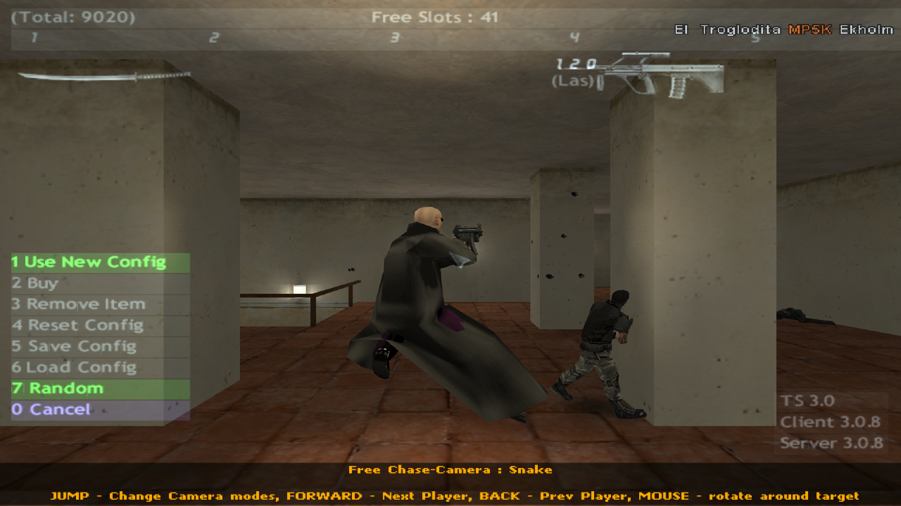
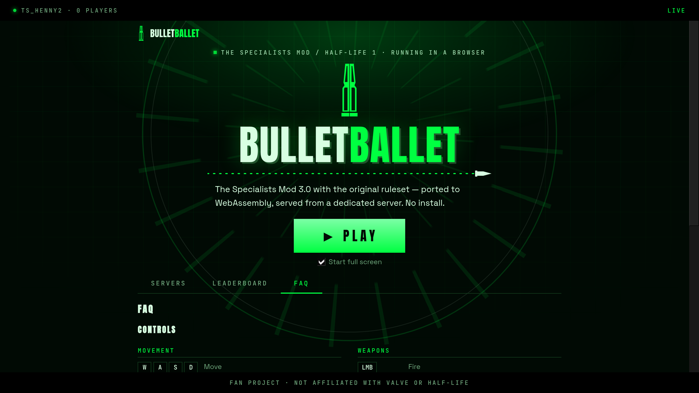
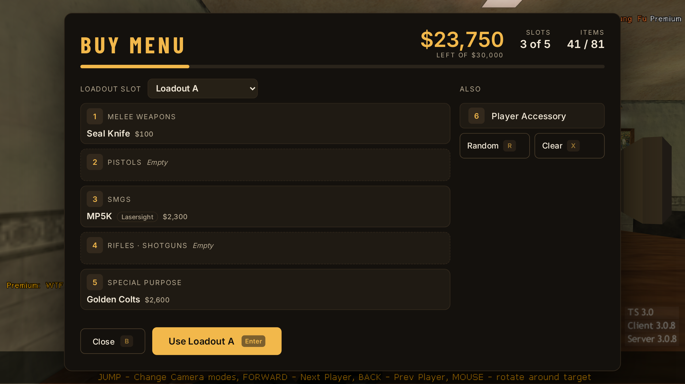
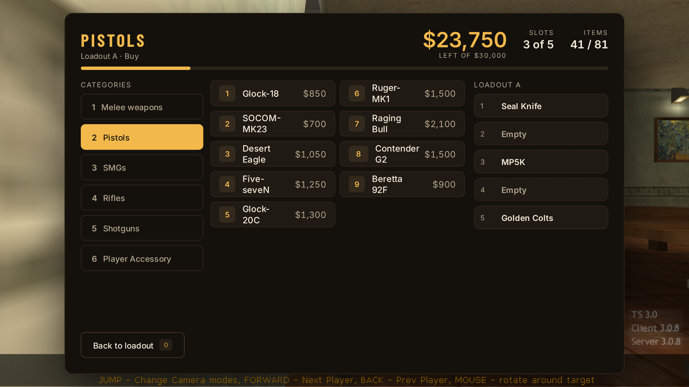
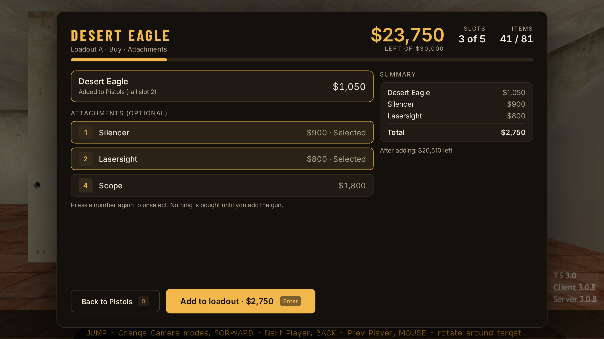

# BulletBallet

> **The Specialists** — a Half-Life 1 mod — running in a browser tab, played
> against a real dedicated server. No Steam client, no native binary.

**Play it → <https://bulletballet.dev>**

The first visit downloads the 493 MiB game archive — about 30 seconds on a
100 Mbps line, and cached in the browser after that. Nothing to install, no
account, no Steam. It needs a current browser: Chrome, Edge, Firefox 119+ or
Safari 18+.

<table>
  <tr>
    <td align="center" valign="top" width="50%">
      
      <br><sub>The landing page — the server list, the leaderboard, and an FAQ built from the game's own bind table.</sub>
    </td>
    <td align="center" valign="top" width="50%">
      
      <br><sub>In game — the mod's own HUD and kill feed, with the buy menu open.</sub>
    </td>
  </tr>
  <tr>
    <td align="center" valign="top" width="50%">
      
      <br><sub>The FAQ tab — the controls are the game's own, read out of its bind table.</sub>
    </td>
    <td align="center" valign="top" width="50%">
      
      <br><sub>The buy menu — the money is the hero, and every price comes from the server's rules.</sub>
    </td>
  </tr>
</table>

## What it actually is

Most "play this game in the browser" projects reimplement the game in
JavaScript. This one does not. The rules you play are the original rules,
running as real code:

- **The mod's own Rust port**, compiled to WebAssembly and loaded by the
  stock Xash3D engine as a side module.
- **The real dedicated server**, built from that same port and running in
  Docker — 32 slots, 100 Hz, The Specialists' own 21-map cycle.
- **A WebSocket↔UDP bridge**, because a browser cannot emit UDP and the
  engine's network stack speaks it natively.
- **The engine's own key handling**, used as it is. The page translates no
  keys at all.

## The four things that make it work

None of them is obvious, and each one cost a debugging round.

1. **A Rust port of the game's logic**, compiled to a WebAssembly side
   module the stock engine loads — so the rules are real code, not a
   JavaScript reimplementation.
2. **A WebSocket↔UDP bridge**, because a browser cannot emit UDP and the
   engine speaks it natively.
3. **The engine's own key path**, used as it is — measured, not assumed.
   The front end's job is to stay out of the way.
4. **A gate fix in the port**, because the mod deliberately refuses to run
   nine button commands unless a physical keypress opened them.

<details>
<summary><b>1. The Rust port as a WASM side module</b></summary>

`tools/port/tsp-rs/` is a vendored copy of `the-specialistsmod-rs` (pinned
in `PINNED-VERSION`), a Rust reimplementation of The Specialists' gameplay.
It builds twice from one source tree:

| Target | Crate | Produces |
|---|---|---|
| `wasm32-unknown-emscripten` | `ts-client` | `client_emscripten_wasm32.wasm` — the client DLL |
| native `x86_64` | `ts-server` + `ts-server-dll` | the dedicated server |

The client DLL is a **side module**, not a standalone program. The engine
resolves its exports through a `DLINK` export table at boot, exactly as it
does for a native `.dll`. That is why the port can be dropped into the
stock engine without touching engine code.

```bash
tools/port/tsp-rs/scripts/build-wasm.sh              # → dist/
tools/port/tsp-rs/scripts/deploy-wasm-to-webxash.sh   # → webxash/public/cl_dlls/
```

Always deploy with the script. Hand-copying the artifact is how you end up
debugging a build that was never served.

</details>

<details>
<summary><b>2. The WebSocket↔UDP bridge</b></summary>

`tools/port/tsp-rs/scripts/ts-udp-bridge.js`. The engine's `net_ws.c` calls
POSIX `sendto`/`recvfrom`; Emscripten's socket emulation falls back to `-1`
for every call when `Module.net` is undefined, with no warning. The bridge
supplies it.

Non-obvious requirements, each of which cost a debugging round:

- **One UDP socket per WebSocket connection.** The engine keys clients on
  source `address:port`, so a shared socket gives every browser the same
  client slot.
- **Inbound packets must be stamped with the real peer address** parsed
  from `+connect <ip>:<port>`. The engine drops any datagram whose source
  does not match `cls.serveradr` (or loopback) *after* reading it — no
  error, no log. A loopback placeholder is correct for WebRTC P2P and
  silently fatal for a dedicated server.
- **`/health` with byte and packet counters.** It is the only way to
  distinguish "transport dead" from "handshake wrong" without a browser in
  the loop.
- **`-noip`/`-noip6` must be absent from launch args.** With both set the
  engine prints `TCP/IP Disabled.` and returns before ever calling
  `socket()`, which looks exactly like a broken transport.

In production the bridge is **multi-target and allowlisted**. Without an
allowlist it is an open UDP relay: anyone who can open a WebSocket can
make the host send packets to anything it can reach. The registry may tell
the bridge *where* to send a packet; only the floor says whether it is
*allowed* to — `127.0.0.1` on a static port range. Unknown targets are
refused **before** the handshake, with a plain 403, because a connection
that opens and then closes reads to the client as "connected".

</details>

<details>
<summary><b>3. The keyboard path</b></summary>

The engine's keyboard works. With the TS client's own `ts_dev_keylog 1`, in
a real Chromium against a live server:

```
[ts key] HUD_Key_Event escape down=1 binding="cancelselect" -> 1
[ts key] cancelselect: escape
```

The engine's `keydown` listener fires, reaches `HUD_Key_Event`, and runs
its own bind table — `ts/config.cfg` already binds movement, weapon slots,
chat, third person, reload and use.

The long-held belief that the engine never sees a key was **wrong**, and it
cost a bug: the front end *also* translated every DOM key into an engine
command, so every key ran twice. That is the whole of "typing triggers hot
keys AND types at the same time" — Y opened the chat twice, and the real
keystroke typed a `y` into a chat that was already open — and of third
person looking broken, because X ran `thirdperson` twice, on then straight
back off.

So there is no command map any more. What the front end still does:

- **Nothing, for most keys.** The engine's bind table runs them.
- **Opens TS's anti-script gate** for the gated button commands it handles
  (movement, jump, duck, reload), and releases the held command on key-up
  (see §4).
- **Bridges the two mouse buttons** — `attack` and `attack2`.
- **Keeps Escape away from the engine.** `escape-gate.ts` intercepts the
  key on `window` with `capture: true`, registered at module load —
  before the engine boots and registers its own listener — and calls
  `stopImmediatePropagation()`. Escape #1 releases the pointer lock,
  Escape #2 opens the options overlay, Escape #3 closes it. It is a
  state machine rather than a read of `document.pointerLockElement`,
  because the browser exits pointer lock on Escape on its own, which
  would make the first press look like the second.

Two entries are cleared in the engine's own bind table at boot
(`xash-loader.ts`): **the backquote and `~`** (the console) and **Escape**
— the last one as a second line of defence behind the DOM interception.

**`b` is not cleared any more.** It used to be, and "pressing **B** does
nothing" was true here. The game's own `config.cfg` binds `"b"` to
`"buy"`, so the loader now leaves that line alone and re-binds `b` to
`buy` on the frame after the engine starts (and again at +2s), in case
the config's line is ever disturbed. The buy menu is the client's own
canvas menu: it opens when the client is an observer — on join and after
every death — and is navigated with the weapon-slot keys. **B** opens it,
**0** closes it, **B** opens it again.

Two things are still out of reach, and neither is a bug in the front end:
**typing into the console** (its binding is cleared and nothing opens
it), and a **bare `reload`**, which aborts the WASM heap — see
[`docs/UPSTREAM-ISSUES.md`](./docs/UPSTREAM-ISSUES.md). The engine's
*notify* window — the leftover boot chatter it draws over the top-left of
the game — is retired with `+con_notifytime 0`, a cvar the engine reads,
not a patch.

</details>

<details>
<summary><b>4. <code>ts_gate</code> — the anti-script gate</b></summary>

TS makes nine button commands reachable only after a real keypress:

```rust
// crates/client/src/input.rs
fn gate_open() -> bool { REAL_KEY.0.get() || !input_gate() || dev_input_allowed() }
// REAL_KEY: set only by HUD_Key_Event, cleared by HUD_Frame
```

`+attack +attack2 +alt2 +reload +forward +back +moveleft +moveright +jump`

`REAL_KEY` is set for the frame a keypress happens in, and `HUD_Frame`
re-arms it afterwards. A gated command that arrives without it is
**discarded silently** — no error, no log — which is why the gate is worth
an explicit look rather than a guess.

`ts_gate <1-500>` sets `REAL_KEY` for the current frame, the same lifetime
a real keypress gives it. The bridge calls it immediately before any gated
command it sends. It is **not** a blanket bypass: bounded duration, caller
is the bridge, and `HUD_Frame` re-arms the gate exactly as before.

</details>

## The buy menu

The game has always had a buy menu and it is still there. The **classic**
flow is the client's own canvas menu — top-left of the in-game shot above.
It opens the moment you arrive as an observer and after every death, and
**B** brings it back.

The **modern** flow is a new DOM panel over the live game: a loadout
screen, a per-slot browse screen and an attachments screen, with the money
as the hero and the price of every line in the summary. You pick the flow
in the options overlay (**Esc** twice → *Buy menu: Classic / Modern*), and
the choice is remembered.

The server owns the flow, not the browser. The panel draws what the port's
own state line says, and the only thing it sends back is a key — so the
prices are the ruleset's, at runtime, and never a table copied into
JavaScript.

<details>
<summary>The browse screen and the attachments screen</summary>

<table>
  <tr>
    <td align="center" valign="top" width="50%">
      
      <br><sub>The browse screen — categories, prices, and the keys that pick them.</sub>
    </td>
    <td align="center" valign="top" width="50%">
      
      <br><sub>The attachments screen — optional, and nothing is bought until you add the gun.</sub>
    </td>
  </tr>
</table>

</details>

## Run it yourself

Three processes, in three terminals:

```bash
# 1. Dedicated server (UDP 27015), data root /tmp/tsds
tools/port/tsp-rs/scripts/start-ts-server.sh

# 2. WebSocket↔UDP bridge (WS 27017)
tools/port/tsp-rs/scripts/start-bridge.sh

# 3. Frontend (Vite) — a bun project; there is no npm lockfile
cd webxash && bun install && bun run dev
```

Then open the Vite URL and press **Play** — pick a name and a character,
and you are in:

```
https://100.95.111.112:5174/
```

Append `&debug=1` for session-level logging, `&debug=trace` to also trace
every packet, `&hud=vue` to show the Vue HUD (hidden by default so it
cannot occlude the real one).

> **The local loop works.** A browser client reaches a local game server:
> the bridge advertises a public address and resolves it to an internal
> UDP target (`--targets default=127.0.0.1:27015@<public>:27015`), so the
> browser never emits UDP itself. Gameplay changes are therefore verified
> against a local server instead of against production.

<details>
<summary>Server configuration — the two values that bite</summary>

Stock TS is **free-for-all deathmatch**. The shipped `server.cfg` does not
set `mp_teamplay` (default `0`). The four visible "teams" are character
*model* groups from `mp_teammodels`, not sides.

- **`ts_gameplay`** selects the ruleset. `30` is TS 3.0 (default, ignores
  map prefix); `21` is TS 2.1 (map-aware). The client WASM is built
  `--features ts30` **only** — running the server on `21` desyncs, and the
  engine says so on every connect: `the server's ruleset "21" isn't in
  this client; predicting with "30"`.
- **`mp_defaultteam 1`** is not an auto-assign switch. In this port it
  triggers a path that overwrites the client's `model` key with the team
  name and prints `* HLDM models not allowed.` Leave it `0` and use
  `mp_teamoverride 1`.

A third trap: the config parser tokenizes bare cvar assignments inside
`//` comments as commands. A comment line like `// ts_gameplay 21 means…`
becomes a command and logs `log: unknown parameter 1`.

For a headless dedicated you need a stdin channel to run server commands:

```bash
echo "ts_status" >> /tmp/tsds/engine.console
```

`start-ts-server.sh` tails that plain file into the server's stdin. **Not a
named FIFO** — a FIFO blocks on open until a peer arrives, so a dead
reader hangs the next start forever while the script still exits 0.

</details>

## What works today

Verified from a real browser against production, not from a test harness:

- **Two browsers in the server at once**, each with its own server-side
  client slot, with the bot roster scaling down as they arrived.
- **A player joining from a cold browser**, downloading 493 MiB, booting
  the engine, and appearing on the server's player count.
- **The server dying under a live player**, and the client saying so
  ("The game server is restarting") and reconnecting on its own.
- **The server being restarted by the orchestrator** (~80s from dead to
  healthy) without touching a healthy instance.

And the limits worth knowing before you play:

- **The first run downloads 493 MiB.** ~30–40s on a 100 Mbps link, ~90s on
  50 Mbps, ~6 minutes on a slow mobile connection. Cached after that.
- **The player count lags by up to two minutes** after someone leaves — the
  server holds the slot until its own timeout fires.
- **The console is disabled**, on purpose: its binding is cleared at boot
  and nothing in the front end opens it.
- **A bare `reload` aborts the WASM heap.** The front end uses the held
  `+reload` / `-reload` pair and never hits it; the engine defect is
  still there.

## The server behind it

```
browser
  │  https://bulletballet.dev/
  ▼
Caddy (Let's Encrypt, cert valid to 2027-01-21)
  ├── /              → /srv/web          app bundle, 56 MB
  ├── /api/servers   → 127.0.0.1:8081    registry container
  └── /bridge        → 127.0.0.1:27017   bridge container (WebSocket)
                                              │
                                              └─ UDP → 127.0.0.1:27015 → ts-0

assets.bulletballet.dev  →  Cloudflare R2 (ts-assets), 493 MiB in 8×64 MiB parts
```

The game UDP port is published straight out of Docker and deliberately does
**not** go through Caddy — it is raw UDP, not HTTP. Four containers do the
work: `ts-0` (the dedicated server), `bridge` (WebSocket↔UDP, allowlisted),
`registry` (the fleet's source of truth) and `orchestrator` (the decision
maker — restart unhealthy, scale out, scale in).

The full topology, the control plane's policies and the capacity numbers
are in [`docs/PRODUCTION-INFRA.md`](./docs/PRODUCTION-INFRA.md).

<details>
<summary>Asset delivery, map rotation and capacity</summary>

**Asset delivery.** The game archive is 493 MiB, which is larger than a
browser will hold in memory as one blob and larger than is sensible to
serve uncompressed. It is split into eight 64 MiB parts plus a manifest,
uploaded to Cloudflare R2, and served through the Cloudflare edge with
immutable caching. The edge is the point: the first player to fetch a part
warms it for everyone after. A cold fetch measures ~41 MiB/s from a fast
link; a warm one is served from the edge.

Two traps live here, both documented in
[`docs/ASSET-DELIVERY.md`](./docs/ASSET-DELIVERY.md):

- **The storage key layout must mirror the dev-served layout exactly.**
  On localhost the two lookups are independent and one of them succeeds,
  so the mismatch does not show up until it hits a real bucket — as a
  total 404 of the delivery path.
- **`vary: Origin` means a cached pre-policy response keeps missing its
  CORS header** until that per-origin variant is purged. A policy in the
  wrong shape is accepted, renders plausibly, and does nothing.

**Map rotation.** The server cycles through **The Specialists 3.0's own map
cycle** — the one that shipped in the mod's Linux server tarball, twenty-one
maps, in the mod's own order — plus the two classics TS 3.0 dropped from
its default file while still shipping them (`ts_dietrich`, `ts_bikini`).
Two things make it work, and both were broken before: the cycle file has to
be ours (the asset tree ships the stock Half-Life one, and the port skips
every entry it cannot resolve and ends up with an *empty* cycle, which is
not an error — the server just keeps one map forever, silently), and
`mp_timelimit` is the timer that ends the match, in **minutes** —
`roundtime` is the TS *round* timer and is inert in FFA deathmatch.

**Capacity.** "Eight instances of 32 slots on this box" is **a plan, not a
promise**. RAM allows ~9 instances; CPU allows ~4–5, and **CPU is the one
that binds** — two vCores shared with Caddy and three Node services. The
bot roster is sixteen, so the RAM figure (365.5 MB, measured with four
bots) is stale in the direction that matters. What the sixteen-bot roster
does *not* cost is tickrate: measured on every map of the rotation with
the server pinned to two cores, the server held **100 Hz** on all of them.
The bots are cheap; the maps are what differ.

</details>

## For contributors

| Looking for | Read |
|---|---|
| The current state and the next task | [`HANDOFF.md`](./HANDOFF.md) |
| The design and why it is that way | [`SPEC.md`](./SPEC.md) |
| Working on this repo with an agent | [`AGENTS.md`](./AGENTS.md) |
| Production topology and the control plane | [`docs/PRODUCTION-INFRA.md`](./docs/PRODUCTION-INFRA.md), [`docs/CONTROL-PLANE.md`](./docs/CONTROL-PLANE.md) |
| The CI gate and the deploy | [`docs/CI-CD.md`](./docs/CI-CD.md) — including the two traps that have already broken a build |
| The front end and mod work list | [`docs/FE-MOD-PLAN.md`](./docs/FE-MOD-PLAN.md) |
| A symptom with one upstream cause | [`docs/UPSTREAM-ISSUES.md`](./docs/UPSTREAM-ISSUES.md) — read this before starting work |

<details>
<summary>Repo layout</summary>

| Path | What it is |
|---|---|
| `webxash/` | Vue frontend + the WASM engine (git submodule, branch `main`) |
| `tools/port/tsp-rs/` | Vendored Rust port of TS gameplay |
| `tools/port/tsp-rs/crates/ts30/`, `ts21/` | TS 3.0 / 2.1 rulesets |
| `tools/port/tsp-rs/scripts/` | Build, deploy, server, bridge, and probe scripts |
| `tools/deploy/` | Container images, Caddy config, instance runner, e2e tests, and `config/` — `server.cfg` and the map cycle |
| `tools/decompile/` | The parked AI-decompile output — the single-player fallback |
| `tools/assets/` | Archive splitter and R2 uploader |
| `services/registry/` | The fleet registry |
| `services/orchestrator/` | The fleet orchestrator |
| `services/a2s/` | The original A2S service the registry grew out of |
| `docs/` | Production topology, control plane, asset delivery, upstream issues, historical scopes |

The vendored port is pinned by `PINNED-VERSION`. It is a copy, not a
submodule, so the build stays reproducible offline.

</details>

<details>
<summary>Testing, CI and deployment</summary>

```bash
# Browser → server smoke test
tools/port/tsp-rs/scripts/smoke-browser-to-server.js

# Frontend only
tools/port/tsp-rs/scripts/smoke-webxash.js

# The regression suite
npm test
```

Probes live in `tools/port/tsp-rs/scripts/probes/`. Archived investigation
scripts are under `.../probes/d7-keyboard-investigation/` — they are kept
because the negative results are what ruled out whole theories.

The production suite lives in `tools/deploy/` and runs against the live
site — a real browser, a real server, and the server's own player count as
the verdict:

| Script | What it proves |
|---|---|
| `two-player-e2e.cjs` | N browsers are in the server *at the same time* |
| `play-button-e2e.cjs` | The **Play** button reaches the server |
| `disconnect-ux-test.cjs` | A player is told when the server goes away |
| `capture-readme-shots.cjs` | Regenerates this README's screenshots |

Two probe rules learned the hard way, worth keeping:

- **A negative result from an unvalidated probe is not evidence.** Always
  run a positive control — a DOM-level listener proving the event actually
  arrived — before concluding the engine never saw it.
- **Instrument the suspect function before you patch it.** A guard in a
  function that is never invoked looks identical to a guard that does not
  work. One `print` at the top of your own handler is the discriminator.

And one that cost a real bug: **a test that only covers the path you
already trust is not evidence about the path you have not tried.** Every
e2e test here originally matched `/join/i` — a server row's *Join* button —
so the suite was exercising the path that already worked while the *Play*
button was broken, and every run passed.

| Workflow | Trigger | What it does |
|---|---|---|
| `ci.yml` | PR, push to main | Frontend typecheck and build, 610 unit tests, the port's Rust suite, and the three service images |
| `pr-required.yml` | push to main | Fails a commit that did not come from a pull request |
| `deploy.yml` | push to main | Ships to production, then verifies it in a real browser |

Merging to `main` builds the frontend, swaps it into place, streams the
control-plane images to the host, recreates the containers, and then
clicks **Play** in a real browser to confirm a player actually arrived.
The deploy is refused for any commit that did not come through a pull
request.

**610 tests.** The design rule is that a test earns its place by locking in
a failure we actually had. The A2S bot count's byte offset, the bridge's
allowlist, the empty-map-versus-unknown distinction in the human count,
scale-out slot selection, and the pull-request gate's own false negative
are all covered.

> **Protection, stated plainly.** The repo is **public** and `main` is
> covered by an **active ruleset**: one approving review is required,
> deletions and force-pushes are refused, and the required status checks
> have to pass. The `pr-required` workflow is the second line of defence —
> it **detects** a direct push and **blocks the deploy**, because the
> workflow cannot prevent the push that already happened. Details in
> [`docs/CI-CD.md`](./docs/CI-CD.md).

</details>

## What is next

- **Matchmaking** — the policy is decided (the fullest server that is not
  full); the implementation is not. The browser currently sorts the
  opposite way.
- **Loading performance** — the 493 MiB archive is inflated on the main
  thread; the inflate wants to be in a worker.
- **More instances** — the box is CPU-bound at four or five 32-slot
  instances. A second host is the only way to offer more.
- **The rebrand is done** — tokens, favicon, landing page, boot screen,
  options overlay and the server's own A2S name (`bulletballet TS`) all
  carry the BulletBallet identity. What is left is the game's *own* art,
  which stays the mod's.

The full list is in [`HANDOFF.md`](./HANDOFF.md) (`§ NEXT TASK`) and
[`docs/FE-MOD-PLAN.md`](./docs/FE-MOD-PLAN.md).

## What we chose not to do

**An x86 emulator.** The original plan ran the mod's closed-source DLLs
unmodified through an x86 emulator in WASM. Shipping a Rust port instead
removed the emulator, the dual-mode build, and a whole class of "is it the
port or the emulator?" ambiguity.

**Our own decompilation.** This project started by decompiling the mod's
client and server to source with an AI pipeline. The upstream project
turned out to have published a Rust reimplementation of the game logic,
which is what ships. The decompiled output is still in the tree as the
single-player fallback, but the grind's logs are gone — there is no point
keeping a diary of a road not taken.

**Matchmaking by skill.** Explicitly out of scope — not ELO-based.

## License

Repo content is MIT. The engine and mod content are **not** covered by this
license: users source those separately and are bound by Valve's HL1 SDK
terms and The Specialists mod's distribution terms.

The game archive is served from a public R2 bucket on Cloudflare. That is
a deliberate call — the browser needs the content, and the server image
stays clean because the assets live in a read-only volume and are never
baked into an image.

The repo is `specialists-browser`; the product is **BulletBallet**.
